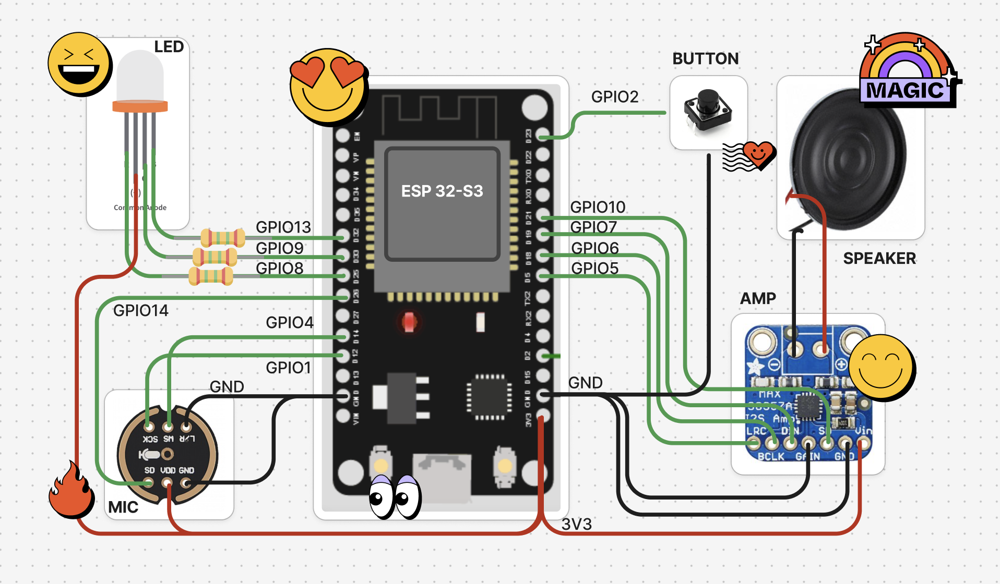
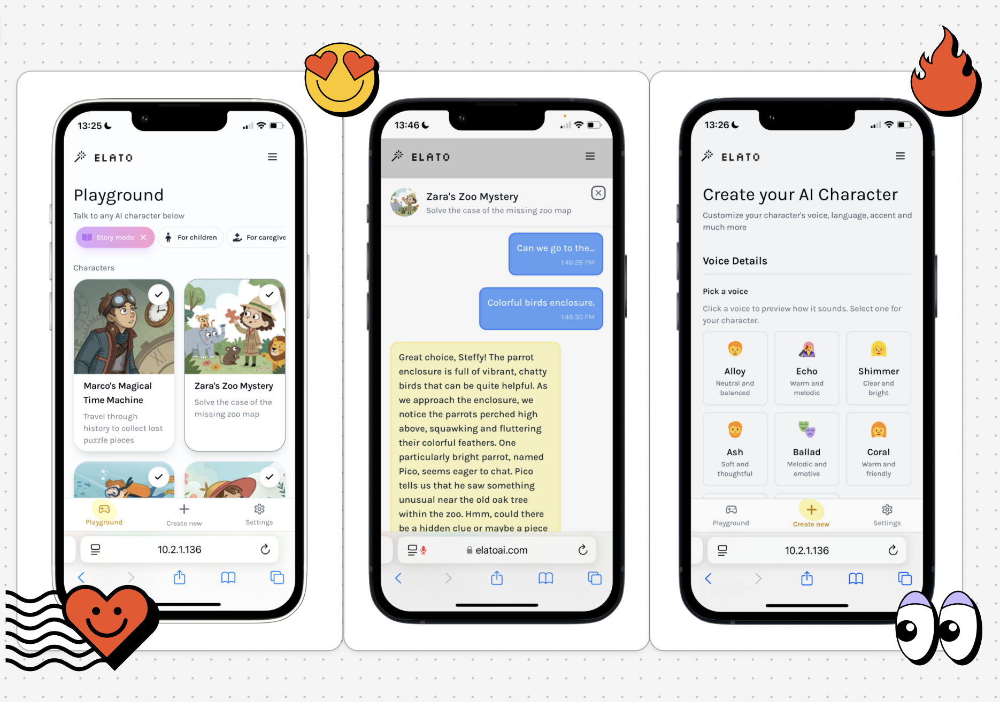
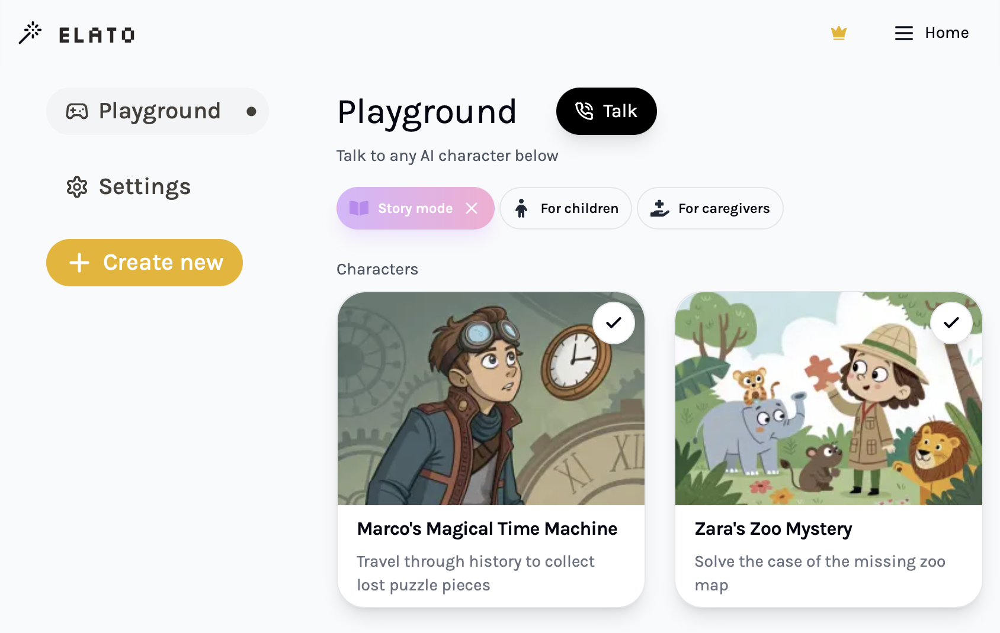
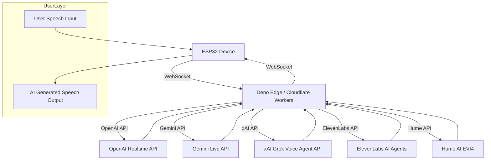
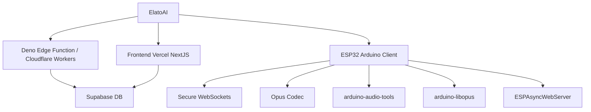

English | [中文](README.zh.md)

<div align="center">

  <a href="https://elatoai.com"><picture>
    <source media="(prefers-color-scheme: dark)" srcset="assets/darkelato.png">
    <source media="(prefers-color-scheme: light)" srcset="assets/lightelato.png">
    
  </picture></a>
  
<div style="display:flex; flex-direction:row; align-items:center; flex-wrap:wrap; justify-content:center;">
  <a style="display:inline-flex;" href="https://cookbook.openai.com/examples/voice_solutions/running_realtime_api_speech_on_esp32_arduino_edge_runtime_elatoai"></a>  
  <a style="display:inline-flex;" href="https://www.elatoai.com/docs"></a>
  <a style="display:inline-flex;" href="https://discord.gg/KJWxDPBRUj"></a>
<!-- <a style="display:inline-flex;" href="https://elatoai.com/home"></a> -->
      <a style="display:inline-flex;" href="https://www.kickstarter.com/projects/elatoai/elato-make-toys-talk-with-ai-voices"></a>
 <!-- <a style="display:inline-flex;" href="https://www.elatoai.com/products/ai-devkit"></a> -->
</div>
<a href="https://www.kickstarter.com/projects/elatoai/elato-make-toys-talk-with-ai-voices" target="_blank">
 
</a>

<br />
</div>

## News
- **Apr 17 2026:** Create a Global Devices/Toys network with Cloudflare Voice Agents and Durable Objects. Cloudflare's Workers AI provides Deepgram STT/TTS natively so all you need to bring is an LLM API Key to create a scalable, low-latency voice AI pipeline.
- **Apr 15 2026:** You can launch over 100+ STT, LLM, TTS voice pipeline systems with a FastAPI server with Pipecat!
- **Mar 14 2026:** Elato just launched Local AI Toys on Pi Day.🎉🎉 Your ESP32 devices can now support local AI models and voice generation with frontier Local LLMs and TTS models like Qwen, Mistral, and more with MLX. Check it out [here](https://www.github.com/akdeb/local-ai-toys). 

# 👾 ElatoAI: Realtime Voice AI Models on Arduino ESP32

Realtime AI Speech powered by 100+ Voice AI models on ESP32, with Secure WebSockets & Edge Functions for >20-minute uninterrupted conversations globally.

- [⌨️ Easy Cardputer setup with your own API key (start here)](#easy-cardputer-setup-preview)
- [Original ElatoAI-hosted Cardputer setup](#cardputer-installation-and-setup)
- [Cardputer firmware details](firmware-arduino/README.md)
- [Independent service / private owner setup](independent/README.md)
- [Upstream Quick Start / self-hosting](https://www.elatoai.com/docs/quickstart)
- [Build with PlatformIO](https://www.elatoai.com/docs/platformio)
- [Build on Arduino IDE](https://www.elatoai.com/docs/arduino)
- [Deploy globally](https://www.elatoai.com/docs/blog/deploying-globally)
- [🤖🤖🤖 Deploy multiple devices](https://www.elatoai.com/docs/blog/multiple-devices)

## Easy Cardputer setup (preview)

Install one firmware, enter your Wi-Fi and voice-provider details on the
Cardputer, and start talking. You do not need an ElatoAI account, a Supabase
project, your own Vercel deployment, or a `PersonalConfig.h` file for this edition.

1. Connect your original M5Stack Cardputer to a computer with a USB-C **data**
   cable. Open the [Cardputer Voice installer](https://cardputer-voice.vercel.app/setup)
   in desktop Chrome or Edge and follow its installation steps. USB installation
   replaces the firmware currently on the device, including Launcher.
2. Follow the Cardputer's on-screen Wi-Fi setup. Choose your **2.4 GHz** network
   and type its password using the keyboard. Press **Enter** to continue.
3. Choose your provider: **Gemini**, **ElevenLabs**, or **Hume**. Enter your own
   provider API key. ElevenLabs also needs your existing **Agent ID**; Hume needs
   your existing **Config ID**. Create those in the provider's own dashboard first.
4. Finish the on-screen prompts. Wait for the greeting and **LISTENING**, then
   speak. Your settings are saved for later boots.

To change the key or provider later, hold **Fn + W for two seconds**. Choose
**Enter: keep Wi-Fi** to avoid typing the Wi-Fi password again, or **Tab: change**
to choose another network.

For actual cloned voices, use an ElevenLabs agent or Hume configuration with a
voice available in that provider account. This port reuses ElatoAI's existing
provider integrations; Gemini's built-in voices are a separate choice.
Provider charges and account restrictions still apply, and clone access is not
guaranteed to be free. The shared preview has a 10-minute daily allowance per
provider key and a 20-minute daily allowance across all guests.

The original private-owner voice path has been tested on a Cardputer. The new
Easy setup and provider-entry path is still awaiting hardware verification.
See the [Easy setup guide](independent/README.md#easy-setup-for-your-cardputer)
for provider requirements, usage limits, privacy, and the optional build command.

## Cardputer installation and setup

The steps below install the **original ElatoAI-hosted edition**, rather than
the Easy bring-your-own-key edition above. For an independent private-owner
deployment, see the [independent-service guide](independent/README.md).

This is an unofficial community port of [ElatoAI](https://github.com/akdeb/ElatoAI)
for the M5Stack Cardputer. It uses the built-in microphone, speaker, screen, and
keyboard, so no external audio hardware or wiring is needed. The original
Cardputer has been tested with repeated conversations and long voice replies;
Cardputer v1.1 and ADV support has not been physically verified for this port.

These steps use **ElatoAI's hosted service**, the default `ELATO_MODE` in this
fork. You need an ElatoAI account with available hosted usage. You do not need
to run a local server or supply your own model API key for this setup. Voice
audio is sent to ElatoAI's service; check your account for current usage limits
and character availability.

### 1. Get what you need

- An M5Stack Cardputer and a USB-C **data** cable.
- A computer with [Git](https://git-scm.com/downloads) and
  [Python 3.12](https://www.python.org/downloads/) installed. Python 3.12 is the
  version used to build and test this port. On Windows, include the Python
  launcher (`py`) when installing Python.
- A 2.4 GHz Wi-Fi network with internet access.
- Your own [ElatoAI account](https://www.elatoai.com/).

### 2. Download this fork and install the build tools

On **Windows**, open PowerShell in the folder where you want to keep the project
and run these commands one line at a time:

```powershell
git clone --branch main https://github.com/ImPapaGhost/ElatoAI.git
cd ElatoAI\firmware-arduino
py -3.12 -m venv .venv
.\.venv\Scripts\python.exe -m pip install platformio==6.1.19
.\.venv\Scripts\python.exe -m platformio run -e m5stack-cardputer
```

Keep using this terminal in `ElatoAI\firmware-arduino` for the remaining commands.
The first build downloads the compiler and libraries and can take several
minutes. Wait for `SUCCESS` before continuing. The commands call the virtual
environment directly, so there is no activation script to run.

<details>
<summary>macOS / Linux commands</summary>

With Git and Python 3.12 installed, run:

```bash
git clone --branch main https://github.com/ImPapaGhost/ElatoAI.git
cd ElatoAI/firmware-arduino
python3.12 -m venv .venv
./.venv/bin/python -m pip install platformio==6.1.19
./.venv/bin/python -m platformio run -e m5stack-cardputer
```

For the commands below, replace `.\.venv\Scripts\python.exe` with
`./.venv/bin/python` and `COM3` with your device's port, such as
`/dev/cu.usbmodem...` on macOS or `/dev/ttyACM0` on Linux.

</details>

### 3. Flash the Cardputer over USB

Connect the Cardputer with the USB-C data cable and turn its power switch on.
Find its serial port:

```powershell
.\.venv\Scripts\python.exe -m platformio device list
```

Find the USB serial device that appears when you plug in the Cardputer. In the
next command, replace `COM3` with that port:

```powershell
.\.venv\Scripts\python.exe -m platformio run -e m5stack-cardputer -t upload --upload-port COM3
```

Wait for the upload to finish with `SUCCESS`. **Copy the address printed next to
`MAC:` in the upload output**; you will use this Cardputer's address to register
it with ElatoAI. It has six pairs of characters, like `AA:BB:CC:DD:EE:FF`.

If the upload stays at `Connecting...`, hold **G0**, press and release **Reset**,
release **G0**, and retry the upload. After a successful upload, tap Reset if the
firmware does not start automatically.

This USB installation writes the bootloader and partition table as well as the
app. It replaces the existing firmware, including an installed Launcher. If you
want to keep Launcher, see the Launcher note below before flashing.

### 4. Connect the Cardputer to Wi-Fi

1. When the screen says `SET UP WI-FI`, use a phone or computer to join the
   **ELATO-DEVICE** Wi-Fi network. Stay connected even if it says "no internet."
2. On that same phone or computer, open
   [http://192.168.4.1/wifi](http://192.168.4.1/wifi).
3. Choose **Manual Connect**, enter your **2.4 GHz** home Wi-Fi name and password,
   and save it. **Scan for Networks** is optional.
4. Press **Reset on the Cardputer** to connect to the saved network, then reconnect
   your phone or computer to your normal Wi-Fi.

If `192.168.4.1` times out, first check that the phone or computer is still
connected to **ELATO-DEVICE**. The setup address is only reachable on that network.
Saved Wi-Fi networks are reused on later boots.

### 5. Register the device and choose a character

1. Sign in to [ElatoAI](https://www.elatoai.com/home) using your own account.
2. Open [Settings → Device](https://www.elatoai.com/home/settings/device) and use
   the DIY-device registration option to register the **MAC address from step 3**.
   Follow the site's prompts until the device is shown as registered.
3. Return to the [dashboard](https://www.elatoai.com/home), choose an available
   character, and select it so it is marked **LIVE**. We tested this port with
   **Ted the Teddy**; choose Ted if it is available in your account.
4. Tap **Reset** on the Cardputer so it reconnects with your registration and
   character selection.

Character selection belongs to each ElatoAI account; Ted is not bundled into
the firmware. For details about ElatoAI's hosted registration flow, see its
[Quick Start → Choose Edge Server option](https://www.elatoai.com/docs/quickstart#choose-edge-server-option).

### 6. Start talking

The Cardputer should connect, play the character's greeting, and show
**LISTENING**. Say a short sentence, then pause. It should show **THINKING**,
then **SPEAKING**, and return to **LISTENING** after the reply finishes. Wait
for **LISTENING** before your next turn; the microphone and speaker take turns.

After setup, you can disconnect USB and use the battery. On later boots, the
Cardputer reconnects using its saved Wi-Fi and account token.

### Controls, updates, and quick fixes

- **Sleep / wake:** hold G0 to sleep; press G0 to wake.
- **Account token reset:** hold **Fn + Backspace/Delete** for two seconds if the
  saved token is stale or you have moved the device to another account. This
  clears the device token and restarts it while preserving saved Wi-Fi. Register
  the device to the intended account on the website first.
- **Connected but no greeting:** check that the MAC is registered to the right
  account, a character is LIVE, and the account has available hosted usage; then
  tap Reset.
- **Serial diagnostics:** run
  `.\.venv\Scripts\python.exe -m platformio device monitor --port COM3 --baud 115200`.
  Replace the port as above. Press **Ctrl+C** to close the monitor before flashing.
- **Install future versions:** from `firmware-arduino`, run `git pull --ff-only`,
  then repeat the USB upload command in step 3. This port's hosted firmware/OTA
  update is not configured; use the fork's USB upload path for updates.

**Launcher users:** the build produces
`firmware-arduino/.pio/build/m5stack-cardputer/firmware.bin` (relative to the
repository root). This is an application image, not a merged USB-flash image.
Installation through Launcher has not yet been tested for this port; the steps
above describe the tested direct USB installation. See
[Launcher's binary-installation guide](https://github.com/bmorcelli/Launcher/wiki/Obtaining-binaries-to-launch)
if you want to test installing the app through Launcher.

For advanced firmware settings, self-hosting, and hardware notes, see the
[Cardputer firmware README](firmware-arduino/README.md).

## 📽️ Demo Video

<div align="center">
    <a href="https://www.youtube.com/watch?v=o1eIAwVll5I" target="_blank">
    
  </a>
</div>

Video links: [OpenAI Demo](https://youtu.be/o1eIAwVll5I) | [Gemini Demo](https://youtu.be/_zUBue3pfVI) | [Eleven Labs Demo](https://youtu.be/7LKTIuEW-hg) | [Hume AI EVI-4 Demo](https://youtu.be/Gtann5pdV0I)

## 🧠 Models

### Deno Edge
1. [OpenAI Realtime API](https://github.com/akdeb/ElatoAI/tree/main/server/deno/models/openai)
2. [Gemini Live API](https://github.com/akdeb/ElatoAI/tree/main/server/deno/models/gemini)
3. [xAI Grok Voice Agent API](https://github.com/akdeb/ElatoAI/tree/main/server/deno/models/grok)
4. [Eleven Labs Conversational AI Agents](https://github.com/akdeb/ElatoAI/tree/main/server/deno/models/elevenlabs)
5. [Hume AI EVI-4](https://github.com/akdeb/ElatoAI/tree/main/server/deno/models/hume)
6. More speech to speech models coming soon!

### Cloudflare Workers
1. LLM - [80+ Models](https://developers.cloudflare.com/workers-ai/models/?tasks=Text+Generation) OpenAI, Gemini, xAI, and more.
2. TTS - [10+ Models](https://developers.cloudflare.com/workers-ai/models/?tasks=Text-to-Speech) Deepgram, MeloTTS and more.
3. STT - [5 Models](https://developers.cloudflare.com/workers-ai/models/?tasks=Automatic+Speech+Recognition) Whisper, Deepgram and more.

### FastAPI
Select from 100+ models from the list above and use the FastAPI server to create your own voice pipeline. Check out the [FastAPI server](https://github.com/akdeb/ElatoAI/tree/main/server/fastapi) for more details.


## 👷‍♀️ DIY Hardware Design



### M5Stack Cardputer

This fork includes a ready-to-build firmware target for the M5Stack Cardputer,
Cardputer v1.1, and Cardputer-Adv. It uses the built-in screen, microphone,
speaker, battery monitor, and G0 sleep/wake button while retaining the original
generic ESP32-S3 target. See the [Cardputer build and first-boot guide](firmware-arduino/README.md).

## 📱 App Design

Control your ESP32 AI device from your phone with the ElatoAI webapp.




<!-- ## ⭐️ Key Voice AI Features
 -->

## 🌟 Full feature list

1. **Realtime Speech-to-Speech**: Instant speech conversion powered by OpenAI's Realtime API, Gemini's Live API, xAI's Grok Voice Agent API, Eleven Labs Conversational AI Agents and Hume AI EVI4.
2. **Create Custom AI Agents**: Create custom agents with different personalities and voices.
3. **Customizable Voices**: Choose from a variety of voices and personalities.
4. **Secure WebSockets**: Reliable, encrypted WebSocket communication.
5. **Server VAD Turn Detection**: Intelligent conversation flow handling for smooth interactions.
6. **Opus Audio Compression**: High-quality audio streaming with minimal bandwidth.
7. **Global Edge Performance**: Low latency Deno Edge Functions ensuring seamless global conversations.
8. **ESP32 Arduino Framework**: Optimized and easy-to-use hardware integration.
9. **Conversation History**: View your conversation history.
10. **Device Management and Authentication**: Register and manage your devices.
11. **User Authentication**: Secure user authentication and authorization.
12. **Conversations with WebRTC and Websockets**: Talk to your AI with WebRTC on the NextJS webapp and with websockets on the ESP32.
13. **Volume Control**: Control the volume of the ESP32 speaker from the NextJS webapp.
14. **Realtime Transcripts**: The realtime transcripts of your conversations are stored in the Supabase DB.
15. **OTA Updates**: Over the Air Updates for the ESP32 firmware.
16. **Wifi Management with captive portal**: Connect to your Wifi network or Hotspot from the ESP32 device.
17. **Factory Reset**: Factory reset the ESP32 device from the NextJS webapp.
18. **Button and Touch Support**: Use the button OR touch sensor to control the ESP32 device.
19. **No PSRAM Required**: The ESP32 device does not require PSRAM to run the speech to speech AI.
20. **OAuth for Web client**: OAuth for your users to manage their AI characters and devices.
21. **Pitch Factor**: Control the pitch of the AI's voice from the NextJS webapp to create cartoon-like voices.
22. **Tool calling**: Call tools and functions from the ESP32 device to the edge Functions for a complete voice AI agent.
23. **Tap to turn on**: Tap the touchpad to turn it on from sleep.
24. **Deploy on Cloudflare**: Connect to any LLM, TTS, STT service with Cloudflare Voice Agents and Durable Objects

## Project Architecture

ElatoAI consists of three main components:

1. **Frontend Client** (`Next.js` hosted on Vercel) - to create and talk to your AI agents and 'send' it to your ESP32 device
2. **Edge Server Functions** (`Deno Edge` or `Cloudflare Workers`) - to handle the websocket connections from the ESP32 device and the LLM Provider API calls
3. **ESP32 IoT Client** (`PlatformIO/Arduino`) - to receive the websocket connections from the Edge Server Functions and send audio to the LLM Provider via the Deno edge server or Cloudflare Durable Objects.


## 🛠 Tech Stack

| Component       | Technology Used                          |
|-----------------|------------------------------------------|
| Frontend        | Next.js, Vercel            |
| Backend         | Supabase DB  |
| Edge Functions  | Deno Edge or Cloudflare Workers          |
| IoT Client      | PlatformIO, Arduino Framework, ESP32-S3  |
| Audio Codec     | Opus                                     |
| Communication   | Secure WebSockets                        |
| Libraries       | [ArduinoJson](https://github.com/bblanchon/ArduinoJson), [WebSockets](https://github.com/Links2004/arduinoWebSockets), [AsyncWebServer](https://github.com/ESP32Async/ESPAsyncWebServer), [ESP32_Button](https://github.com/esp-arduino-libs/ESP32_Button), [Arduino Audio Tools](https://github.com/pschatzmann/arduino-audio-tools), [ArduinoLibOpus](https://github.com/pschatzmann/arduino-libopus)        |

## High-Level Flowchart




## Project Structure



## 📊 Important Stats

- **Latency**: <2-3s round-trip globally
- **Audio Quality**: Opus codec at 12kbps (high clarity) 24kHz sampling rate
- **Uninterrupted Conversations**: Up to 20 minutes continuous conversations globally
- **Global Availability**: Optimized with edge / monolith servers

## 🛡 Security

- Secure WebSockets (WSS) for encrypted data transfers
- Optional: API Key encryption with 256-bit AES (decrypted on server)
- Supabase DB for secure authentication
- Postgres RLS for all tables

## 🚫 Limitations 
- 2-3s cold start time while connecting to edge server
- Tested with up to 17 minutes of uninterrupted conversations
- Edge server stops when wall clock time is exceeded
- No speech interruption detection on ESP32

## 🙌 Contributing

We value your contributions! Here are some ideas to get you started:
1. Speech Interruption on ESP32 (works with OpenAI)
2. ~~Adding Arduino IDE support~~
3. ~~Add Hume API client for emotion detection~~
4. Add MCP support on Deno Edge
5. ~~Plug in Eleven Labs API for voice generation~~
6. Add Azure OpenAI Support (easy pickens) - in review
7. Add Cartesia Support
8. Add Amazon Nova Support
9. Add Deepgram
10. ~~Add Cloudflare Workers support~~


## License

This project is licensed under the MIT License - see the [LICENSE](LICENSE) file for details.

**Check out our hardware offerings at [ElatoAI Products](https://www.elatoai.com/). If you find this project interesting or useful, support us by starring this project on GitHub. ⭐**
